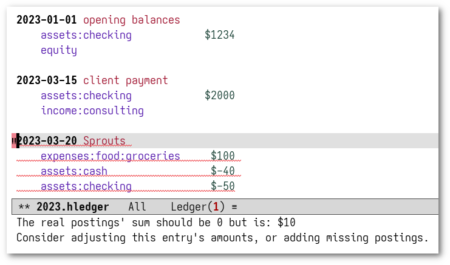

* Flymake-Hledger
  #+BEGIN_HTML
      

        

        

        
      

  #+END_HTML

** Summary

This Emacs package uses [[https://www.gnu.org/software/emacs/manual/html_node/emacs/Flymake.html][Flymake]] to report errors in your [[https://hledger.org/][hledger]]
journal. It works in journal buffers using
[[https://github.com/narendraj9/hledger-mode][hledger-mode]], or [[https://github.com/ledger/ledger-mode][ledger-mode]] with ~ledger-binary-path~ pointing to hledger.
It fully supports hledger 1.40+ and hledger 2, and partially supports hledger 1.26+.

This package is similar to [[https://github.com/DamienCassou/flycheck-hledger][flycheck-hledger]], except that the latter
uses [[https://www.flycheck.org][Flycheck]], which is a separate package you have to install,
whereas Flymake is built into Emacs.

** Installing and configuring

The simplest is to install the package using [[http://melpa.org/][melpa]]. You may otherwise
prefer to clone the project into your Emacs configuration directory
and add the path to the ~load-path~ variable.

To enable Flymake in the current buffer, run ~M-x flymake-hledger-enable~.
Feel free to add this command to the special
~eval~ file or directory-local variables.

hledger [[https://hledger.org/dev/hledger.html#check][features several checks]] including mandatory and optional
ones. Among the optional checks, flymake-hledger enables the strict
checks by default. You should modify the content of
~flymake-hledger-checks~ to change the checks being run on your
journal. Here is an example of initialization code to add to your
Emacs configuration in case you want to enable a few more checks:

#+begin_src emacs-lisp
  (dolist (check '("ordereddates" "payees" "recentassertions" "tags"))
    (add-to-list 'flymake-hledger-checks check))
#+end_src

If you are using ~ledger-mode~ any compatibility script assigned to
~ledger-binary-path~ must have ~hledger~ at the end of the name.

** Usage

When flymake-hledger is enabled in a journal buffer, hledger's ~check~
command is run on the buffer's content, and any problem is
highlighted. hledger stops at the first problem, so there is at most
one at a time.

~M-x flymake-show-buffer-diagnostics~ lists the problem, and
~M-x flymake-goto-next-error~ moves to it. Flymake doesn't bind these
commands to keys by default; you might like to bind them, eg:

#+begin_src emacs-lisp
  (with-eval-after-load 'flymake
    (define-key flymake-mode-map (kbd "C-c ! n") #'flymake-goto-next-error)
    (define-key flymake-mode-map (kbd "C-c ! p") #'flymake-goto-prev-error)
    (define-key flymake-mode-map (kbd "C-c ! l") #'flymake-show-buffer-diagnostics))
#+end_src

** License

See [[file:COPYING][COPYING]]. Copyright (c) 2023 [[mailto:damien@cassou.me][Damien Cassou]].

#  LocalWords:  backend
